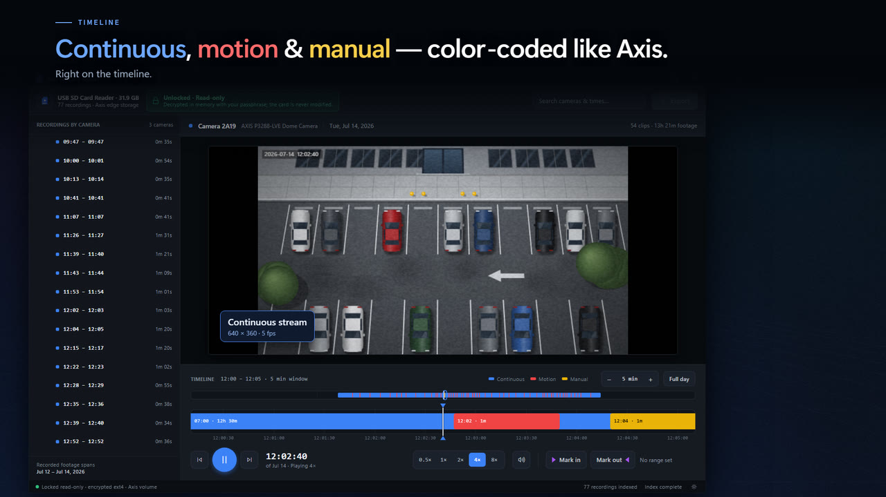

# Axis SD Card Reader

A Windows desktop app for browsing, playing, and exporting video recordings from
micro SD cards used in Axis network cameras ("edge storage"), read directly from
a USB card reader — no ext4 driver installation, no risk of Windows formatting
the card.

## Demo

[](https://github.com/mrdnlabs/axis-sdcard-reader/releases/download/v1.1.1/axis-sd-card-reader-demo.mp4)

**▶ [Watch the one-minute demo](https://github.com/mrdnlabs/axis-sdcard-reader/releases/download/v1.1.1/axis-sd-card-reader-demo.mp4)**
(MP4, 1080p). The video itself is made in JavaScript: the app window is rebuilt
from the real XAML, the camera footage is synthetic, and the soundtrack is
generated with Web Audio. Source in [`demo/`](demo/); `node demo/render.mjs`
rebuilds it.

## Why

Axis cameras format SD cards as **ext4**, which Windows cannot read. Worse,
Windows offers to *format* the "unreadable" card the moment it is inserted.
This app:

- detects the inserted card and immediately **locks the volume and removes its
  drive letter**, so Explorer's format prompt cannot appear;
- reads the ext4 filesystem **strictly read-only** from the raw device
  (`\\.\PhysicalDriveN` opened with `GENERIC_READ` only — the OS itself
  guarantees no writes on that handle);
- indexes recordings from Axis's on-card layout
  (`YYYYMMDD_HHMMSS_xxxx_<cameraMAC>` directories of MKV chunks);
- unlocks **encrypted** cards (LUKS) with the camera's passphrase and reads them
  the same read-only way (see *Encrypted cards* below);
- plays them in-app (H.264/H.265 via LibVLC — no paid Windows HEVC codec
  needed) and exports them to local folders;
- lets **AI agents** (Claude Code, Claude Desktop, any MCP client) look at the
  footage when you switch that on — list recordings, find motion, see frames and
  contact sheets, export clips (see *AI agents (MCP)* below).

## Status

Validated on real Axis cards (plain **and** LUKS-encrypted); ext4 and decryption
paths both proven against hardware.

- [x] Phase 1 — ext4 reading (image-based) with tests
- [x] Phase 2 — raw device access + volume protection + CardProbe harness
- [x] Phase 3 — Axis recording model (sessions, MKV metadata)
- [x] Phase 4 — WPF UI: browse + play (chunk-spanning timeline, speed control)
- [x] Phase 5 — export with progress and verification
- [x] Encrypted-card support — LUKS1 unlock (read-only) with a passphrase prompt
- [x] Validation against real Axis-written SD cards (`CardProbe --disk N`)
- [x] Packaging — self-contained win-x64 zip via `tools\publish.ps1`; CI runs build + tests
- [x] AI agents — MCP server (`AxisSdReader.Mcp.exe`): recordings, coverage, frames, contact sheets, clips

## Encrypted cards

Newer Axis firmware can encrypt the SD card (System → Storage). Encrypted cards
are **LUKS** containers (dm-crypt, `aes-xts-plain64`) wrapping the same ext4
filesystem. When the app detects one it prompts for the camera's SD-card
passphrase, derives the key (PBKDF2), and decrypts sectors **in memory** as it
reads — the card is still never written, and the passphrase is never stored.
Only **LUKS1** is supported today; a LUKS2 card is detected and reported as an
unsupported format (Argon2id support is future work). The crypto uses .NET's
built-in AES/PBKDF2 (AES-XTS layered on AES) — no external crypto dependency.

## Trying it without hardware

```
dotnet run --project tools\CardProbe -- --image tests\fixtures\axis-card-v4.img
dotnet build src\AxisSdReader.App && src\AxisSdReader.App\bin\Debug\net10.0-windows\AxisSdReader.App.exe tests\fixtures\axis-card-v4.img
```

(The fixture image is generated on first `dotnet test` run via WSL.) Opening a card image needs
no administrator rights, so this runs without a UAC prompt.

## Validating a real card

1. Insert the SD card via the USB reader.
2. From an **elevated** terminal: `dotnet run --project tools\CardProbe` to find the disk number,
   then `dotnet run --project tools\CardProbe -- --disk N`.
3. If the probe reports `Status: Ok` and lists recordings, run the app and open the card.

## Building

Requires the .NET 10 SDK on Windows (pinned by `global.json`: any 10.0 feature band). WSL (with `e2fsprogs`) is used
to generate the ext4 test fixture image on first test run. Packaging
(`tools\publish.ps1`) also needs the Visual Studio C++ build tools, for the launcher.

```
dotnet build
dotnet test
powershell -File tools\publish.ps1 -Version X.Y.Z    # the release package, verified
```

Reading a real card needs administrator rights (raw disk access on Windows is
admin-only). The app gets them only through **`AxisSdReader.exe`**, a small native
launcher and .NET host (`src\AxisSdReader.Launcher`) that runs the app with a clean
environment; see *Security model*. A plain `dotnet build` also makes
`AxisSdReader.App.exe`, which never asks for elevation: it hands over to the launcher if
one is beside it, and otherwise opens card images only. (Release packages don't contain
it.)
Packages restore in locked mode from `packages.lock.json`; after changing a package
reference run `dotnet restore --force-evaluate` and commit the updated lock files.

## AI agents (MCP)

The release includes **`AxisSdReader.Mcp.exe`**, a [Model Context Protocol](https://modelcontextprotocol.io)
server. An AI agent uses it to review footage alongside you: find when motion
happened, look at frames, scan a whole period on one contact sheet, export a clip,
or move the app's playhead to show you what it found.

**Turn it on in the app:** click **AI agents: off** in the status bar (bottom right).
It is off by default, is never remembered, and turns itself off again when the card
closes (a different card needs a fresh go-ahead) or the app does. While it is on, the dot
next to it lights up whenever an agent makes a request.

**Add the server to your agent** (use the folder you installed the app in):

```
claude mcp add axis-sd-reader -- "C:\Program Files\Axis SD Card Reader\AxisSdReader.Mcp.exe"
```

or, for Claude Desktop and other clients, in their MCP settings file:

```json
{
  "mcpServers": {
    "axis-sd-reader": { "command": "C:\\Program Files\\Axis SD Card Reader\\AxisSdReader.Mcp.exe" }
  }
}
```

| Tool | What it does |
|---|---|
| `get_status` | what is open: card, cameras, recordings, footage dates; what the app is showing |
| `list_cameras` | cameras and their sources (lenses), with first/last footage |
| `list_recordings` | recordings by camera, source, time window and type (continuous / motion / manual / scheduled) |
| `get_coverage` | when footage exists in a range, per type, and the gaps — e.g. every motion event in a day |
| `get_frame` | **the picture at a moment**, timestamp burned in |
| `get_contact_sheet` | **one image of up to 36 timestamped frames** spread across a period, skipping gaps |
| `export_clip` | saves a range as MP4/MKV (lossless) and returns the file path |
| `get_app_view` | what you're looking at right now, with the current frame |
| `show_in_app` | moves the app (paused) to a camera and time, optionally marking an export range |

It speaks MCP **2026-07-28** (the current revision) and falls back to the older handshake for
clients on 2025-11-25 and earlier. Every tool declares an output schema and returns structured
results alongside readable text; the slow ones (contact sheets, clip export) report progress.

Times are the computer's local time (`2026-07-02T08:15:00`); an explicit offset works too.
Clips go to `%LOCALAPPDATA%\AxisSdReader\agent-clips` (`--clips-dir` to change; this
folder is never synced by OneDrive) and are limited to 10 minutes (`--max-clip-minutes`)
and 8 files per request, each capped in size and never allowed to fill the drive. The
folder holds at most 20 GB of clips (delete old ones to make room), and a request that
fails part way keeps none of its clips. A clip whose footage can't all be read (a damaged
card, a card removed mid-export) fails rather than coming out short. (If the server process
itself is killed mid-export, the file it was writing stays behind, incomplete.)

**Without the app:** `AxisSdReader.Mcp.exe --image card.img` reads an unencrypted card
image directly. Encrypted images are refused there — the passphrase never passes
through an agent; open those in the app instead.

**What an agent can and can't do.** It sees what you could see in the app: recording
metadata, decoded frames and exported clips. It can't change the card (nothing can),
can't open files you choose, and only moves the app's playhead. While agent access is
on, *any* program running as you can connect the same way, so switch it off when you're
done. The server runs unelevated and does all decoding itself; the elevated app only
answers queries and streams the requested chunks over an unguessable, expiring
`127.0.0.1` URL.

## Export & FFmpeg

Trimmed export (MP4 remux / MKV, cut to the marked in/out range) runs
**FFmpeg** with stream copy (`-c copy`) — no re-encode, so it is fast and
lossless. FFmpeg reads the chunks straight off the card through the app's private
loopback stream (nothing decrypted is ever staged in a temp folder), and is
restricted to the Matroska demuxer and that stream. Each exported file stops at the size
its footage could plausibly have and never takes the last gigabyte of the drive, and a
run that takes far longer than the clip should is stopped. Exports are saved on this
computer: the app runs as administrator, and a network server could redirect where its
files go, so to put a clip on a network share, export it locally and copy it.

**The released package bundles FFmpeg** (an LGPL v3 build with no GPL
components — see [THIRD-PARTY-NOTICES.md](THIRD-PARTY-NOTICES.md)), so export and
the agent tools work out of the box with nothing to install.

When building from source, the app locates `ffmpeg.exe` in this order:

1. an `ffmpeg` folder next to the app executable,
2. next to the app executable directly,
3. on the system `PATH` — **only when not running elevated** (see below).

Because the app runs as administrator, it deliberately does **not** search the
`PATH`: a `PATH` directory writable by a standard user could let that user plant a
binary that then executes with administrator rights. `tools\publish.ps1` fetches the
pinned LGPL FFmpeg build into `src\AxisSdReader.App\ffmpeg\` (gitignored, hash-checked)
so it gets bundled into the package; for a dev build you can drop any `ffmpeg.exe` there
yourself. If FFmpeg is
missing, the app disables trimmed export and says so. (MP4 keeps the original codec —
H.264/H.265/AV1 — so very old players may still need a modern build; a true
re-encode-to-H.264 path and timestamp burn-in are future work.)

## Installing & verifying your download

The release package (`…-win-x64-folder.zip`) is self-contained: the app, the MCP
server, libVLC and FFmpeg, with no prerequisites and no installer.

1. Extract it to **`C:\Program Files\Axis SD Card Reader`** (or anywhere else only
   administrators can change).
2. Run **`AxisSdReader.exe`** and accept the UAC prompt (raw disk access requires
   administrator rights). It is the app's only executable; pin or shortcut it.

**Why the location matters:** the app runs as administrator, so if its folder is
writable by your normal account (Downloads, Desktop, a USB stick), any program running
as you could replace one of its DLLs or `ffmpeg.exe` and get administrator rights the
next time you open it. So before it loads anything from its folder, `AxisSdReader.exe`
checks the folder, the folders above it and every file in it, and the app then checks
everything below (an `ffmpeg` folder moved in from Downloads keeps its old permissions,
for instance). If any of it can be changed without administrator rights — or the folder is
reached through a link, is on a network share, or is on a drive without file permissions
(FAT or exFAT) — the app refuses to start and says why. Delete that copy, download the
release again, check its SHA-256, and extract it into `C:\Program Files`.

The old single-file *standalone* exe is no longer published or buildable, for the same
reason: .NET unpacks it into `%TEMP%`, which is always writable by you, and runs it from
there.

The zip carries the licence texts that must accompany the bundled components (in the
folder itself and under `licenses\`).

The executable is **not code-signed**, so on first run expect:

- a SmartScreen *"Windows protected your PC"* notice → **More info → Run anyway**;
- a UAC prompt showing **Publisher: Unknown**.

To verify integrity out-of-band, compare the release's published **SHA-256** (in the
release notes and `SHA256SUMS.txt`) against your download:

```
Get-FileHash .\AxisSdReader-vX.Y.Z-win-x64-folder.zip -Algorithm SHA256
```

## Security model

The app needs administrator rights only to read the raw card, but everything it
parses comes from the card, so it is written to be hostile-input safe and to give
other programs no foothold in the elevated process:

- **The card is never written.** The raw device is opened `GENERIC_READ`; the ext4 and
  LUKS readers have no write paths; only the card's *own* partition is locked (an encrypted
  one as soon as it is found, before the passphrase is asked for, so Windows' "format this
  disk?" prompt can't act on it while you type). The app keeps checking for the card being
  pulled or swapped, for a volume Windows creates late, and for a lock that failed (often
  just Explorer or an antivirus scanner looking at a new volume), and locks those too.
- **Untrusted parsing is bounded.** Partition tables (read by the app itself, never by the
  disk library: a capped walk of logical partitions, at most 128 GPT entries), the ext4
  filesystem (read by the app's own read-only reader, not a general-purpose library: the
  superblock checked to fit its partition, every file's and folder's extent tree or block map
  checked — in order, inside the volume, never overlapping, its depth and size capped —
  before anything is read through it, folders capped in size and refused when damaged, and no
  link on the card ever followed), LUKS headers (one encrypted volume per card is ever
  unlocked, its key derivation capped per attempt, every round counted), MKV headers and
  duration scans (bounded element counts, sizes and distances), XML (no DTDs, text capped),
  the folder walk (each folder read once, one budget for the whole card, however its folders
  link to each other) and per-recording metadata reads (a byte budget, the card shared read
  by read) are all handled defensively in managed code, and card text reaching agents is cut
  short and stripped of control and invisible characters. libVLC may open card data
  **only** with its Matroska demuxer, with subtitles off. FFmpeg is limited to Matroska and
  the app's own stream.
- **The user's environment can't steer it.** An elevated process gets your environment
  variables, which any program running as you can set — and the .NET runtime acts on some
  of them before the app's own code runs (`CORECLR_PROFILER_PATH` loads a DLL,
  `DOTNET_DbgMiniDumpName` writes a memory dump). So the package's only way into the app is
  `AxisSdReader.exe`, native code that replaces its own environment with one built from
  scratch (system folders from Windows itself, not from variables), turns on Windows'
  image-load and RedirectionGuard protections, checks that only administrators can change
  its folder (see *Installing*) and that it wasn't started through a link, and only then
  loads the .NET runtime from that folder and runs the app in that same process. There is no `AxisSdReader.App.exe`
  in the package that could be elevated some other way ("Run as administrator", a
  compatibility setting), and no command-line arguments reach the elevated app. There is
  no `createdump.exe`, .NET startup hooks and BinaryFormatter are disabled, libVLC's
  plugin/data path variables are cleared, and the current folder is out of the DLL search
  path.
- **FFmpeg never gets administrator rights.** Exports run FFmpeg on a restricted copy of the
  app's token — the Administrators group set to deny-only, every privilege removed, medium
  integrity — so it has your own rights and nothing more: a flaw in its Matroska parser, or
  an export file swapped for a link to a system file while it writes, gains nothing. It gets
  an environment built from trusted values only (no `FFREPORT`, no proxies, no temp folder),
  inherits nothing but its three pipes, and runs in a job that dies with the app and caps its
  memory. An export is stopped when it stops making progress, outgrows what its footage could
  hold (in bytes, or in frames for its length), or the drive runs low, and fails rather than
  coming out short when part of its footage can't be read; the MCP server decodes at most
  four frames at a time, each limited to 8K and two threads.
- **Only what playback needs is loaded.** The bundled libVLC is cut down to an allow-list:
  in-memory stream input, the Matroska demuxer, the decoders and packetizers for what Axis
  cameras record (named one by one), and video/audio output — no network, capture, disc,
  streaming-out, discovery, subtitle or Lua modules, no encoders (so no GPL x264), x64
  only. The package build checks the libVLC files against a pinned list
  (`tools\libvlc-files.txt`) and refuses to finish if one is missing or unexpected.
- **Files it writes into your folders can't be redirected.** The export folder (and each
  folder on the way to the crash log) is opened once, checked to be the plain folder that was
  chosen, held open so it can't be moved or replaced, and every file is created relative to
  that handle — no path is looked up twice, so a link made meanwhile, even a folder turned into
  a junction where it stands, leads nowhere. Files are created exclusively, never follow links
  or hard links, and are pinned while in use. Exports go only to folders on this computer
  that your own account could write to without administrator rights (so a junction swapped
  in for your folder can't aim them at `C:\Windows`), and the crash log is in your
  profile's standard app-data folder, capped at 1 MB, with access tokens masked.
- **Agent access is opt-in and narrow** (see *AI agents*): a per-user pipe that only
  answers known requests, rate-limited, refused while you're in the middle of something,
  and switched off with the card; the media URLs it hands out are unguessable, expiring,
  loopback-only, and FFmpeg is never pointed at anything else.
- **Supply chain.** Every NuGet package is pinned with its content hash
  (`packages.lock.json`, restored in locked mode in CI), restore fails on known-vulnerable
  packages, CI actions are pinned to commit SHAs, and Dependabot watches both. The
  bundled FFmpeg is pinned by SHA-256 and re-checked when packaging.

Known limits:

- Video decoding during in-app playback still happens inside the elevated process
  (libVLC), and the file and folder dialogs run elevated too. Moving the UI and player into
  an unelevated process, with a small elevated broker that only reads the card, would
  remove that; it is future work. Agent frame decoding already runs unelevated, in the MCP
  server, and exports run FFmpeg without administrator rights.
- The card's partitions, filesystem, encryption and recordings are parsed inside the
  elevated app. That parsing is bounded managed code with no way to write the card, but a
  flaw in it could still make a crafted card crash the app. Parsing the card in an isolated
  child process is planned.
- `tools\CardProbe` (a diagnostic for developers, not part of the package) reads cards with
  the app's own readers, except `--luks` and `--unlock`, which find the partition with the
  disk library directly; use it only on your own cards.
- `AxisSdReader.Mcp.exe` never needs administrator rights: if Windows ever asks to run it
  as administrator, say no.

## Key dependencies

| Component | Library | License |
|---|---|---|
| ext4 (read-only) | The app's own reader (`AxisSdReader.Core.Ext4`) | MIT (this project) |
| Raw disk and stream helpers | [LTRData.DiscUtils](https://github.com/LTRData/DiscUtils) (`DiscUtils.Core`) | MIT |
| Video playback | [LibVLCSharp](https://code.videolan.org/videolan/LibVLCSharp) | LGPL 2.1 |
| Trimmed export, agent frames | [FFmpeg](https://ffmpeg.org) (`ffmpeg.exe`, external) | LGPL-3.0 build |
| LUKS decryption | .NET `System.Security.Cryptography` (built-in) | — |
| MCP server | [ModelContextProtocol C# SDK](https://github.com/modelcontextprotocol/csharp-sdk) | Apache-2.0 |

## License

This project is licensed under the **MIT License** — see [LICENSE](LICENSE).
Third-party components it uses or bundles (libVLC / LibVLCSharp under LGPL-2.1,
DiscUtils and CommunityToolkit.Mvvm under MIT, the ModelContextProtocol SDK under Apache-2.0) are attributed in
[THIRD-PARTY-NOTICES.md](THIRD-PARTY-NOTICES.md), which is also included in the
release package.
